# Compass Cover: car insurance quote comparison

A multi-step car insurance quote form that turns into a filterable, sortable, shareable comparison of 15 plans from 7 fictional UAE insurers, with a side-by-side compare view for up to three of them. Built with Next.js 16, React 19, TypeScript and Tailwind CSS v4.

| Light, desktop | Dark, mobile |
| --- | --- |
| 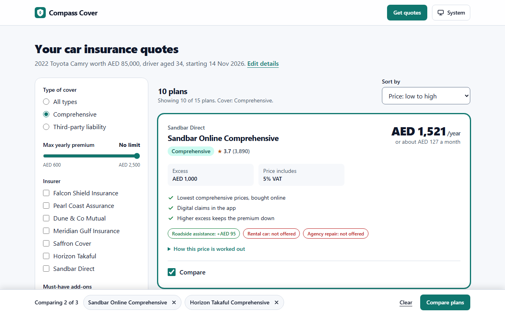 | 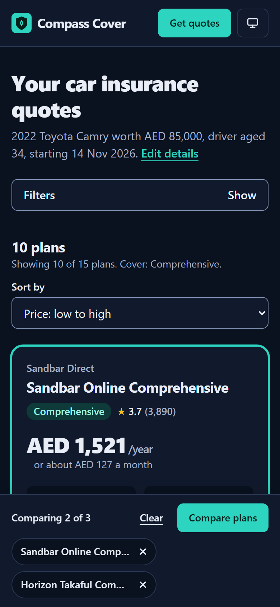 |

- Live demo: https://quote-compare-xi.vercel.app
- GitHub: https://github.com/a4abubakar/quote-compare

## Screenshots

| | Light | Dark |
| --- | --- | --- |
| Landing, desktop | 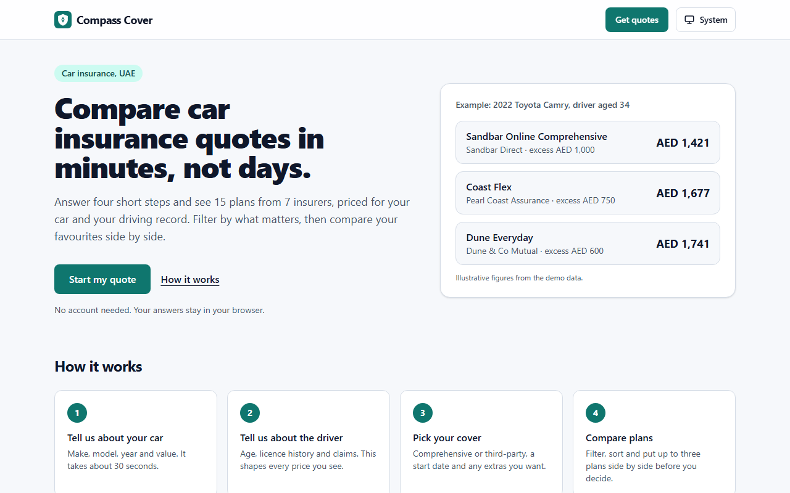 | 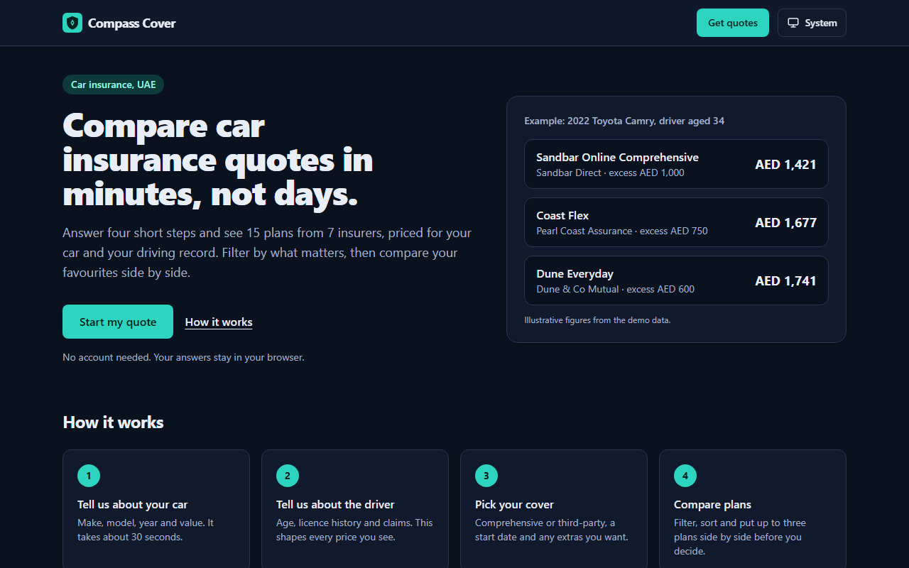 |
| Quote form (validation error), desktop | 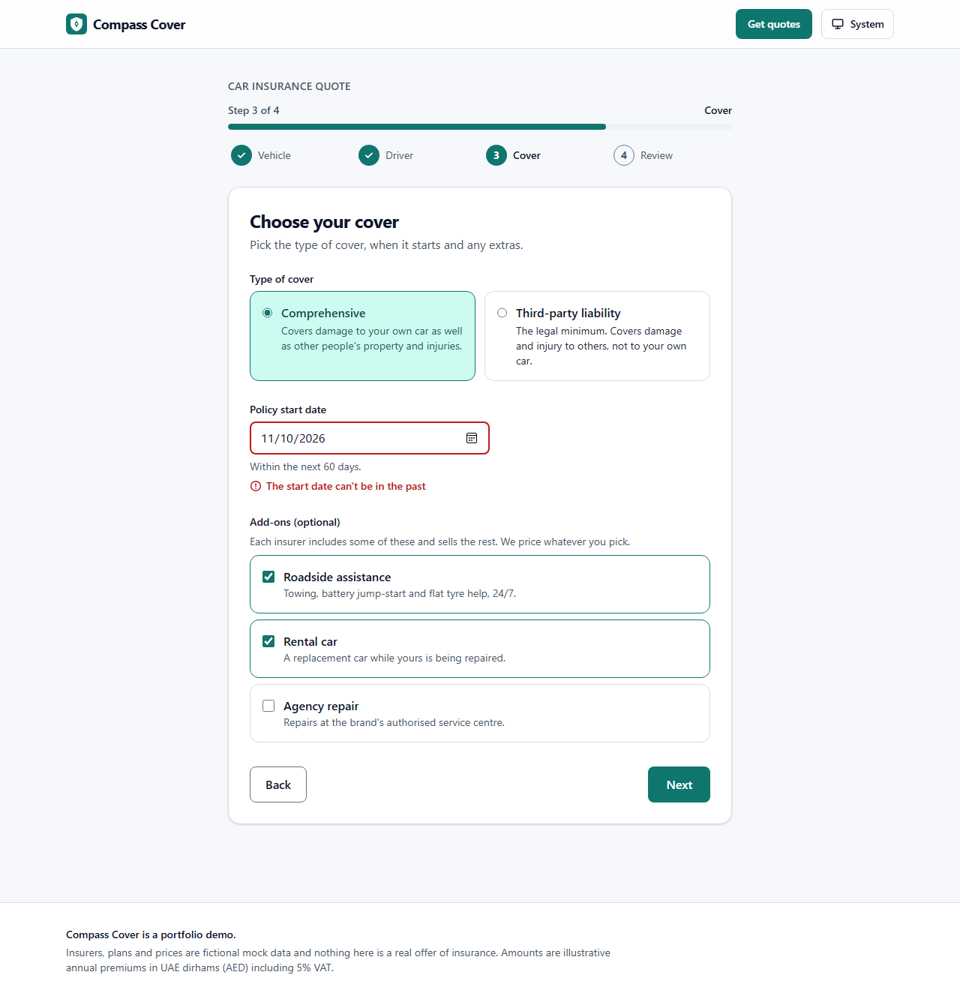 | 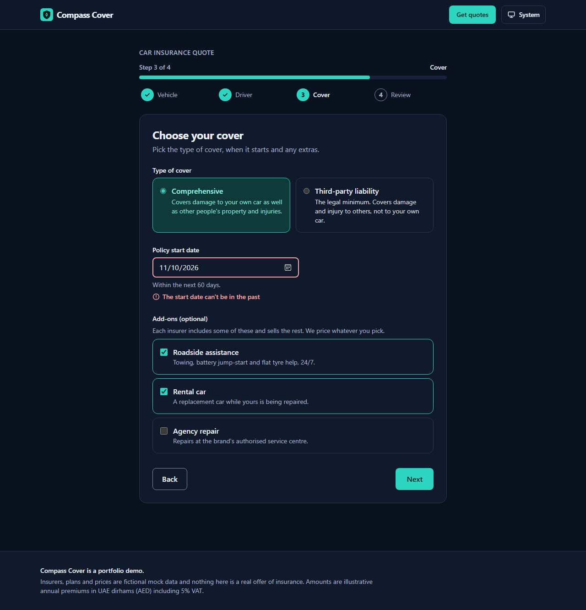 |
| Results, desktop |  | 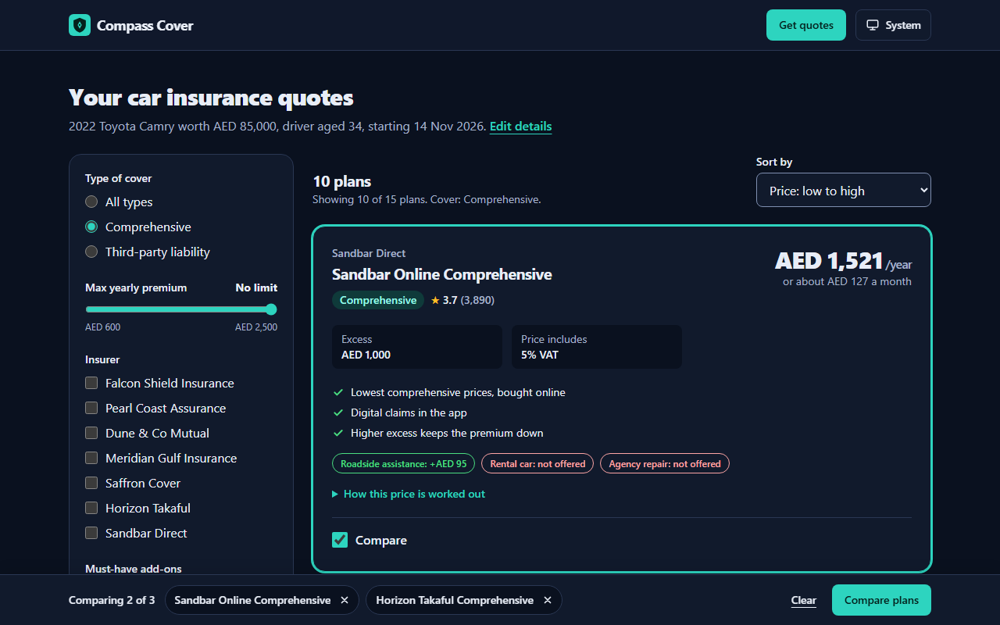 |
| Compare dialog, desktop | 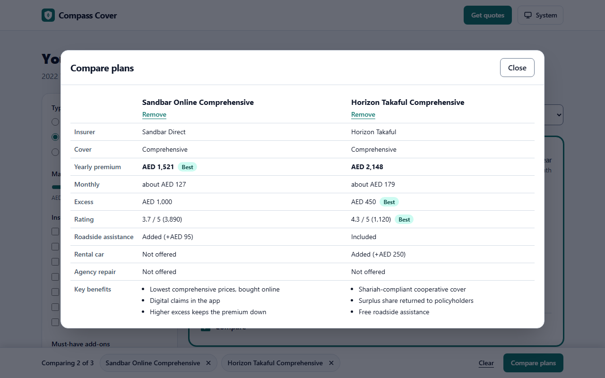 | 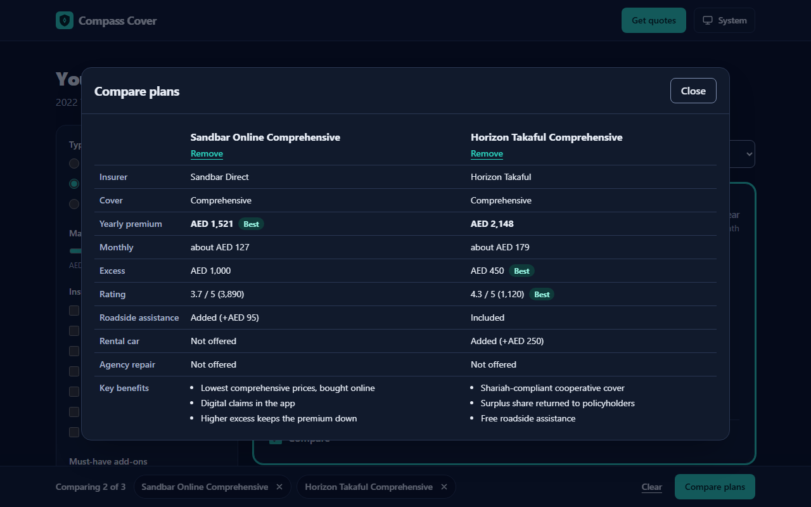 |
| Landing, mobile | 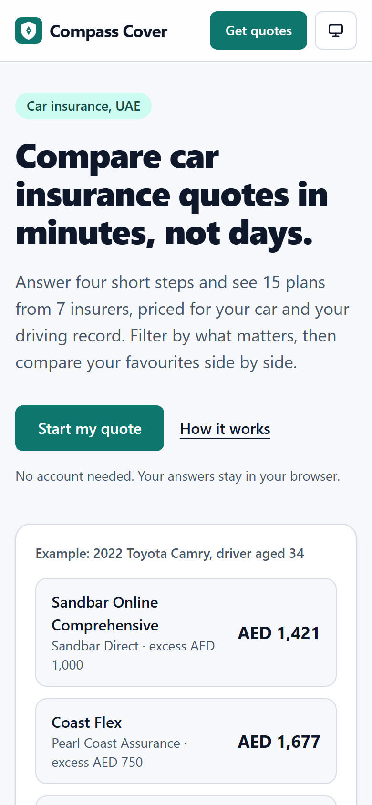 | 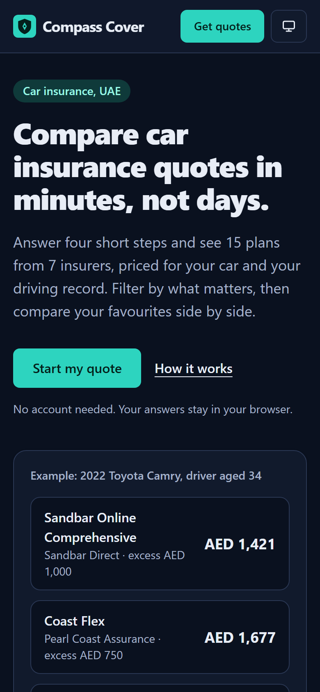 |
| Quote form, mobile | 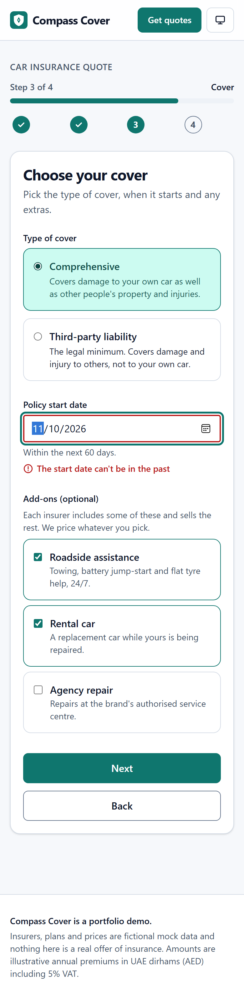 | 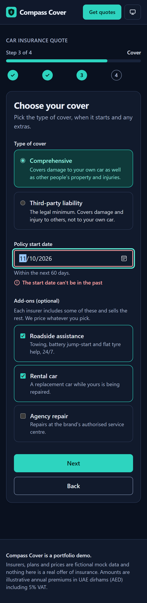 |
| Results, mobile | 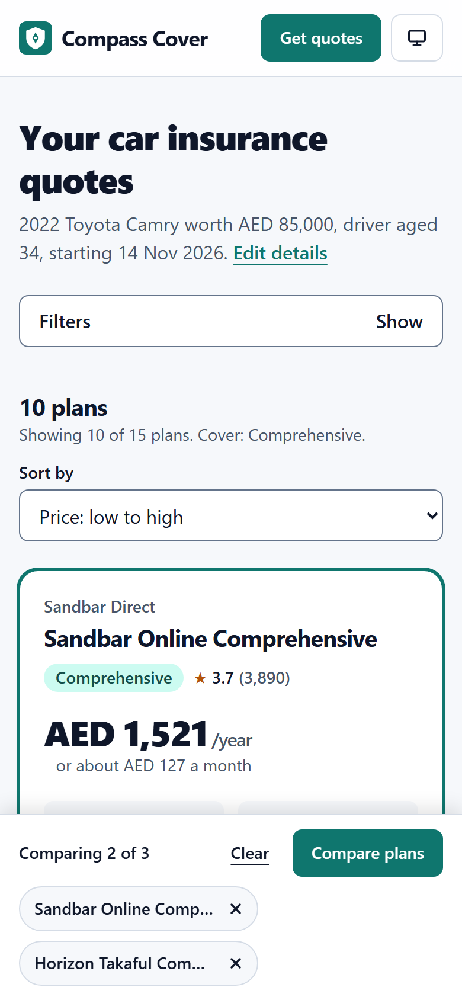 |  |
| Compare dialog, mobile | 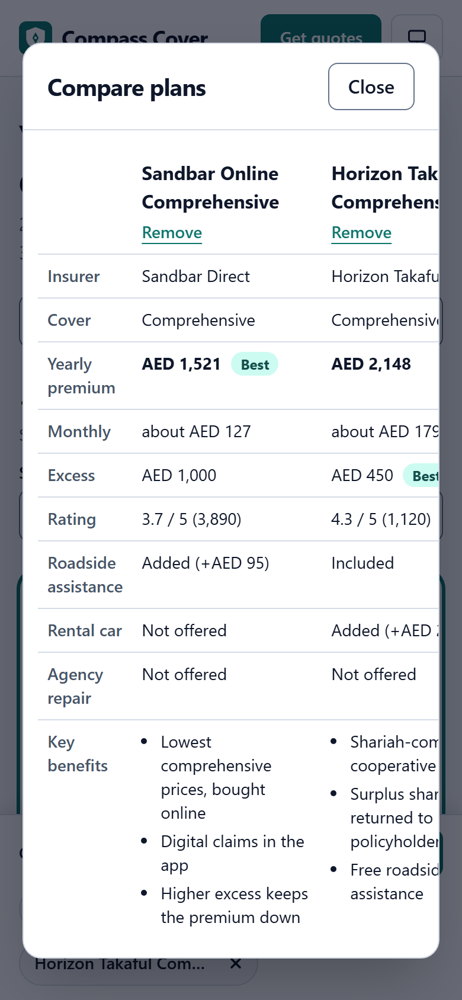 | 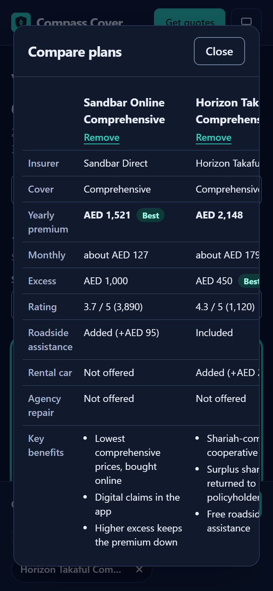 |

Loading skeleton: 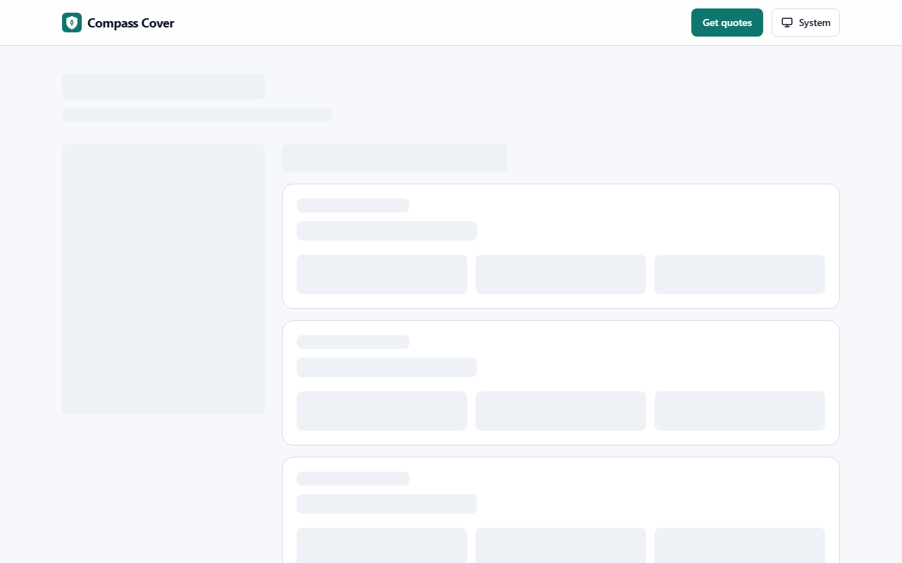

## Features

- **Four-step quote form**: vehicle, driver, coverage, review. Step indicator with a progress bar, Back/Next, and past steps you can click to revisit.
- **Validation with react-hook-form + zod**: one shared schema module drives per-step validation, the final submit check and the results-page URL parsing. Inline errors are linked with `aria-describedby`, fields get `aria-invalid`, focus moves to the first invalid field, and a live region announces how many fields need attention.
- **Form state survives refreshes**: values and the current step are saved to `sessionStorage` as you type. A stale or corrupt draft is handled gracefully.
- **Pure, unit-tested pricing function**: insurer base rate x vehicle value x vehicle age x driver risk (age, licence years, claims) x add-ons, plus 5% VAT. Plans that don't accept the car or driver are dropped.
- **Results with 10 to 15 plan cards**: premium, monthly equivalent, excess, rating, key benefits, add-on status and a "how this price is worked out" breakdown.
- **Filters and sorting in the URL**: cover type, max premium slider, insurers, must-have add-ons, and four sort orders. Results are shareable and the back button steps through filter changes.
- **Compare up to three plans**: a sticky tray and a modal dialog with a side-by-side table and "Best" markers.
- **Empty state** with a "Reset filters" action when the filters exclude everything.
- **Loading and error states**: simulated pricing latency (about 0.9s) shows a skeleton via `loading.tsx` and a Suspense boundary. `error.tsx` has a retry button, plus `not-found.tsx`.
- **Dark mode**: class-based, follows the system by default, persisted, no flash on load.

## Tech stack

Next.js 16.4 (App Router, Cache Components) · React 19 · TypeScript (strict) · Tailwind CSS v4 · react-hook-form 7 · zod 4 · Vitest 5 + Testing Library · Playwright 1.65

## Key decisions

- **Filters live in the URL, but not through the router.** Filter changes use `history.pushState` / `replaceState` (which Next integrates with `useSearchParams`) so filtering is instant and doesn't re-run the server component and its artificial delay. The trade-off: filtering is client-side over the full quote list, which is fine for 15 plans and wouldn't be for thousands. `useOptimistic` keeps controlled inputs from snapping back while Next applies the URL change.
- **The quote input is in the URL too.** Submit navigates to `/results?make=...&age=...`, so there is no server state or database, and any results link is complete and shareable. The server re-validates the params with the same zod schema and shows a friendly message if they are incomplete.
- **One resolver per step.** The form's zod resolver is chosen from the current step. Validating the whole schema on step 1 would skip cross-field rules (zod doesn't run object-level refinements while a field has type errors), so each step validates its own slice and the review step validates everything.
- **Cache Components is on, so the clock is treated as dynamic.** The results route is a static shell (header and skeleton) with the quotes streamed in; `connection()` marks the part that reads the current year. The form renders a skeleton on the server and reads `sessionStorage` through `useSyncExternalStore`, which avoids a hydration mismatch.
- **Native `<dialog>` for the compare view.** Focus trapping, Esc to close and focus return come for free. The table scrolls inside the dialog on small screens, with sticky row labels.
- **Real car makes, fictional everything else.** Vehicle makes and models are ordinary product names used for the dropdowns; all insurers, plans and prices are invented.
- **Mock "pricing service".** `fetchQuotes` waits on purpose. Set `QUOTE_DELAY_MS=0` to remove the delay. `?fail=1` on a results URL makes the service throw, to demo `error.tsx`.

## Project structure

```
src/
  app/
    page.tsx              landing page
    quote/page.tsx        the wizard
    results/              page (Suspense + server data), loading.tsx, error.tsx
    error.tsx, not-found.tsx, layout.tsx, icon.svg, globals.css
  components/
    quote/                wizard, steps, step indicator (+ component test)
    results/              results view, filters, plan card, compare tray + dialog, skeleton
    layout/, ui/          header, footer, theme toggle, form field, error panel
  lib/
    schema.ts             shared zod schemas (steps, full quote, URL variant)
    pricing.ts            pure pricing and eligibility
    plans.ts, catalog.ts  mock market data and reference data
    filters.ts            filter, sort and URL-state logic
    quote-params.ts       quote input <-> URL params
    draft.ts              sessionStorage draft
    quotes-service.ts     simulated latency
e2e/quote-flow.spec.ts    Playwright flow
scripts/screenshots.mjs   README screenshots
```

## How to run

```bash
npm install
npm run dev          # http://localhost:3001
npm test             # Vitest unit and component tests
npm run test:e2e     # Playwright (starts the dev server if it isn't running)
npm run lint
npm run build && npm start
npm run screenshots  # needs the app running on :3001
```

**Playwright browser note:** `playwright.config.ts` and `scripts/screenshots.mjs` set `channel: "msedge"` because the bundled headless Chromium doesn't launch on the machine this was built on. On CI or any machine where Playwright's own Chromium works, delete that one line (`channel: "msedge"`) and run `npx playwright install chromium` once.

## Accessibility notes

- Landmarks (header, nav, main, footer), a skip link, and a single `h1` per page.
- Every input has a visible label; hints and errors are tied to the control with `aria-describedby`; invalid fields have `aria-invalid`.
- Focus moves to the step heading after Next/Back, and to the first invalid field when validation fails.
- Visible 3px focus rings, everything operable by keyboard (including the compare dialog, which traps focus and closes with Esc).
- Result counts and form errors are announced through polite live regions; the loading skeleton is a `role="status"`.
- Colours were chosen for AA contrast in both themes; status is never shown by colour alone (add-on chips and "Best" markers carry text).
- `prefers-reduced-motion` disables transitions and the skeleton pulse.
- An axe-core pass (WCAG 2.0/2.1 A and AA plus best practices) over the home, each form step, results, compare dialog, empty state and 404, in light and dark at 360px and 1280px, found no violations and no horizontal overflow. It was run ad hoc and is not part of the test suite.

## What I'd do next

- Move pricing behind a real route handler or server action with a database of rate tables, and cache it with `use cache` keyed by the quote input.
- Add `@axe-core/playwright` to the e2e suite and a visual regression pass for the screenshots.
- Debounce and virtualise the plan list if the catalogue grows, and move filtering server-side at that point.
- Persist saved comparisons, add "email me this quote", and localise to Arabic with RTL support.
- Per-insurer eligibility reasons ("not offered because the car is older than 12 years") instead of silently hiding plans.

## Author

**Muhammad Abubaker Siddiq**, Senior Frontend Engineer (React, Next.js, TypeScript)

- GitHub: [@a4abubakar](https://github.com/a4abubakar)
- Portfolio: https://portfolio-next-six-tau.vercel.app
- LinkedIn: https://www.linkedin.com/in/muhammad-abubaker-siddiq-27b37615b
